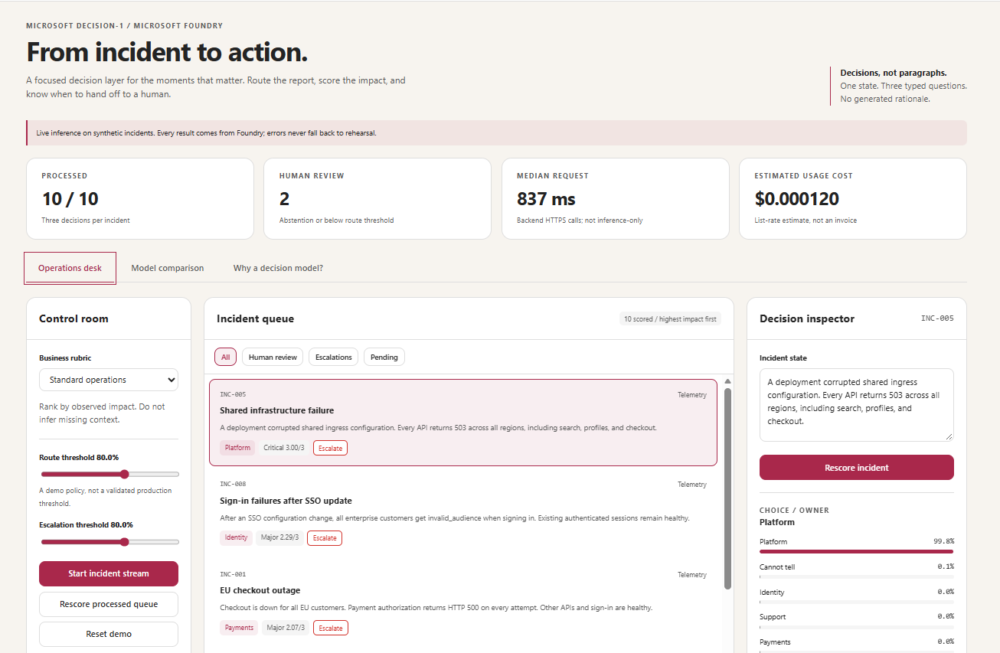
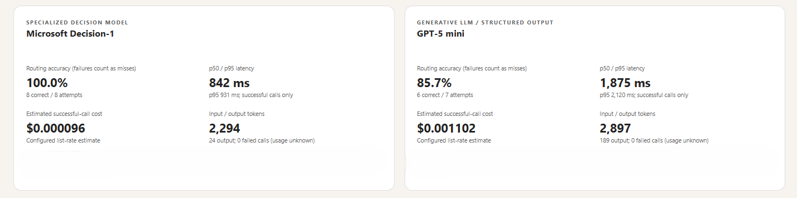

# Incident Dispatch

A synthetic retailer operations demo of Microsoft-Decision-1 on Microsoft Foundry.
It routes reports (`choice`), scores severity (`score`), and assesses immediate human
escalation (`noul`) in one request. No production actions are connected.



*The operations desk with live decisions on synthetic incidents: a prioritized
queue, adjustable routing and escalation thresholds, and a decision inspector.*



*An earlier GPT-5 mini comparison captured mid-run (8 Decision-1 attempts and
7 LLM attempts), not a completed paired benchmark. Deployment labels are
redacted. The current live baseline is GPT-6 Luna.*

## Run

Requires Python 3.10+ and Azure CLI, signed in to the configured subscription.
No Python or JavaScript packages are required to run the app.

For a fresh clone, create your local configuration:

```powershell
Copy-Item config.example.json config.json
```

Replace the `YOUR-*` placeholders with your Foundry resource endpoint, project
label, and deployment names. Set `subscription` to your Azure subscription ID,
or leave it empty to use the Azure CLI's current subscription. The template
contains no credentials or real deployment identifiers. `config.json` is
gitignored and remains local.

```powershell
az login
python app.py
```

Open **http://127.0.0.1:8765**. The server binds to loopback only. An optional
`--port 8766` selects a different port. Keep this a local demo; the standard-library
HTTP server is not intended for public hosting.

Deploy Microsoft-Decision-1 and the optional GPT-6 Luna baseline in your own
Foundry resource. This application does not provision or modify Azure resources.
Edit `config.json` to change deployments. The default Azure CLI subscription is
not changed; token acquisition selects the configured subscription when provided.
Azure tokens are cached in backend memory until shortly before expiry, never
sent to the browser or saved to disk by this app.

Alternatively set `AZURE_API_KEY` in your terminal environment. Do not place keys
in `config.json`, HTML, or source control.

Local benchmark exports and screenshots under `test-results/`, `.azure/`,
`.foundry/`, environment files, and logs are gitignored. The README image is a
separately sanitized asset. Live screens and exported results include your
configured project and deployment labels; review them before sharing externally.

**Offline rehearsal:** open `index.html` directly or select Rehearsal in the
running dashboard. It is self-contained, with authored fixture responses for the
ten bundled incidents and the scripted ambiguity-resolution example. It never
claims real inference, usage, latency, or cost. Arbitrary edited text requires
live Foundry. API errors never switch live requests to fixtures.

## Presenter path

1. Start the incident stream. Observe team probabilities, severity ordering, and
   escalation recommendations. Each live response is inspectable as raw JSON.
2. Select **INC-003**. Inspect the abstention option and human-review policy. Use
   **Add payment failure evidence**, then classify again.
3. Select **Peak sales event**, then **Rescore processed queue**. Inspect
   **INC-006**, where the rubric explicitly promotes regional, multi-customer
   payment failures to Critical. Model outputs may vary; the rubric is not a
   deterministic guarantee.
4. Adjust routing and escalation thresholds. These application policies operate
   on existing probabilities without another model call. Routing requires both a
   non-abstention label and a probability above the threshold.
5. Open **Model comparison**, run the paired live comparison, then export JSON.
   Both models receive the same incident state and decision criteria. Each gets
   one warm-up excluded from the displayed metrics. The LLM uses structured JSON
   output and `reasoning_effort: none` for this bounded classification task;
   it does not invent probability distributions. GPT-6 Luna does not support
   the `minimal` setting used by the previous GPT-5 mini baseline.
   The configured baseline name and reasoning effort are displayed and exported.

## Measurement boundaries

- The ten routing labels are authored expectations, not externally adjudicated
  ground truth. This small synthetic evaluation is a demonstration, not evidence
  of general model superiority or production calibration.
- Accuracy is routing-label agreement divided by attempted calls. Failed calls
  count as misses and remain visible. p50/p95 use successful calls only.
- Latency covers the backend HTTPS request and response, not inference-only
  latency. Initial Azure credential acquisition and UI animations are excluded.
  Calls are sequential, and there are no hidden retries.
- A stop request takes effect after the current model call. Exports record
  partial status, rubric, individual responses, token usage, and failures.
- Queue KPIs cover the latest successful decision per card, not cumulative
  spend across rescoring or comparisons.
- Decision-1 cost is estimated using the published launch rate of **$0.042 per
  million input tokens**, with free output. Output tokens can still appear in
  API usage. GPT-6 Luna Global (short context) cost uses the [public Azure list
  rates](https://azure.microsoft.com/en-us/pricing/details/azure-openai/) of
  **$0.10 per million input tokens** and **$0.50 per million output tokens**,
  verified on October 12, 2026. This estimate treats all input as uncached;
  it does not apply cached-input discounts or negotiated Azure agreement rates.
  Set `baseline_input_usd_per_million` and `baseline_output_usd_per_million`
  in `config.json` to your applicable rates, then restart the server.
  Estimates are not Azure billing totals.
- No generated rationale is displayed. Policy descriptions are deterministic
  application text, not explanations attributed to the model.

## Validation

```powershell
python -m unittest -v
```

Optional end-to-end browser check (with the server running and Microsoft Edge
installed):

```powershell
python -m pip install playwright
python browser_check.py
```

This check makes live model calls, verifies offline rehearsal, error handling,
rubric changes, and responsive layouts, and saves screenshots plus the measured
comparison to the gitignored `test-results` folder.

Use representative labeled data to validate probabilities and tune thresholds
before any production automation. Never use this demo as the sole basis for
consequential decisions about individuals.

[Decision API documentation](https://learn.microsoft.com/en-us/azure/foundry/foundry-models/how-to/use-foundry-models-microsoft-decision)
|
[Microsoft launch announcement and pricing](https://commandline.microsoft.com/microsoft-decision-1-model-foundry/)
